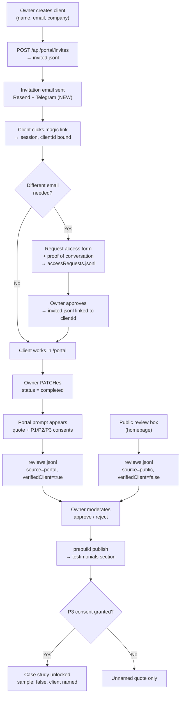

# IXI — Client Profiles & Testimonials: Research & Recommendation

**Owner:** Product Analyst — Requirements Specialist
**Task:** Research + recommendation (client profiles + testimonial capture), on behalf of the owner
**Baseline:** [`spec/06-reviews-portal-requirements.md`](06-reviews-portal-requirements.md) (T6), [`spec/07-reviews-portal-design.md`](07-reviews-portal-design.md) (T7), [`spec/08-portal-mvp.md`](08-portal-mvp.md) (T7b) — all three read in full
**Status:** Draft for M3 review — **recommendations and requirements only. No existing spec file or code file was changed.** Two new files created (this document + flow diagram PNG).
**Owner’s question:** *"okay remove the open registration then and research how is the best way to do this"* — i.e. how should client profiles and testimonials work on the IXI portal?

---

## 0. Recommendation in one page

| # | Decision | Verdict | One-line why |
|---|----------|---------|--------------|
| D1 | **Client profiles: owner-created, invite-only** (client never self-signs up) | ✅ **Keep invite-only** | Every agency client portal surveyed uses explicit invites; self-signup breaks the project↔email binding the whole portal depends on, and buys spam surface instead of clients. |
| D2 | **Testimonials: two doors, one moderation pipeline** | ✅ **Portal prompt is the primary door** | Event-triggered in-app prompts convert **25–40%** vs **5–15%** for email (2026 benchmark data), and a portal prompt is *provably* from a real client on a real project. |
| D3 | **Trigger point: owner marks the project `completed`** | ✅ | Peak-satisfaction moment; the status enum already has `completed`; no new machinery. |
| D4 | **Public review box on the homepage stays** | ✅ Keep as secondary door | Already built, already the fallback for clients who never log in. It just carries less weight. |
| D5 | **Consent is a separate explicit step, not implied by the quote** | ✅ **Two independent permissions, default OFF** | A quote ≠ permission to be *named*. This is what makes the "sample until consented" rule enforceable rather than decorative. |
| D6 | **Public client profile = a Work case study, unlocked by consent** | ✅ | Avoids a second, parallel content system. The `sample: true` label becomes the *default*, not a permanent one. |
| D7 | **Fix the broken testimonials publish pipeline FIRST** | 🔴 **Prerequisite** | The `testimonials` content collection does not exist, so the prebuild script writes files **nothing reads** — the testimonials section is empty and *cannot* currently be non-empty. See §2.3 G1. |

**The short version:** you create the client, you send the invite, the client signs in to their project. When you mark the project complete, the portal asks them once for a testimonial and, separately, for permission to name them publicly. Their words and their permission land in the *same* moderation store as the public review box, get approved by you, and publish on the next build. The public review box stays open as a second door, but you stop depending on it.

---

## 1. What the owner actually asked — and the ambiguity hiding inside it

The owner’s words, over this conversation:

1. *"the person runs a consultancy that gives each client a profile on the website, a profile the person creates and sends to the client."*
2. *"remove the open registration"* (decided — `/register` deleted by Frontend).
3. *"research how is the best way to do this."*

**Ambiguity to flag (this changes the size of the work by roughly 3×):** "a profile on the website" reads two different ways.

| Reading | What it means | Status today |
|---------|---------------|--------------|
| **(A) Private client profile** | The client logs in and sees *their* project, plan items, updates, comments. "A profile the person creates and sends to the client" = you create the client record, you send the magic link. | ✅ **Already built.** `invited.jsonl` → `clients.jsonl` → `/portal`. |
| **(B) Public client profile page** | A page on the marketing site showing the client — their logo, sector, what IXI built for them, their quote. Like `/work/<slug>` but with the real client named. | ❌ **Does not exist.** The `cases` collection is hard-locked to `sample: true`. |

This document covers **both** and gives a recommendation for each. The Manager’s framing in the room leaned on (A) + testimonials; the owner’s original words (“a profile **on the website**”) point at (B) too. **Q1 in §9 asks the owner to confirm which one is meant** — but the recommendation is written so that (B) can be added later without reworking (A).

---

## 2. Verified facts — what exists today (code-read, not assumed)

Everything in this table was read from the repository during this task.

### 2.1 What is already built and working

| Capability | Where | Notes |
|---|---|---|
| Magic-link auth, no passwords | `api/portal/auth.ts` | Generic response for unknown emails — no enumeration (spec P-7). |
| Invite a client | `api/portal/invites.ts` → `site/data/portal/invited.jsonl` | Record: `{ email, name, invitedBy, invitedAt, clientId }`. Idempotent. Owner-only. |
| Client record created on first login | `api/portal/auth.ts` L312–333 → `site/data/portal/clients.jsonl` | `clientId` is back-linked onto the invite record. |
| Project + status enum | `api/portal/projects.ts` L24–31 | `discovery \| in-progress \| review \| completed \| on-hold \| archived`. **`completed` exists.** |
| Plan items, updates, comments | `api/portal/plan-items.ts`, `updates.ts`, `comments.ts` | Server-resolved ownership; cross-client → 403. |
| Public review box | `site/src/components/ReviewForm.astro`, rendered at `site/src/pages/index.astro` L118 | POSTs `type=review` to `/api/contact`. **It is on the homepage.** |
| Moderation store | `site/data/moderation/reviews.jsonl` | `{ ref, type:'review', state:'pending', name, email, company, linkedin, rating, review, receivedAt }`. |
| One-click approve/reject | `api/moderate/review.ts` + `api/lib/notifications.ts` | HMAC-signed link; email **and** Telegram to the owner. |
| Publish approved reviews → site | `site/scripts/publish-testimonials.mjs` (runs on `prebuild`) | Writes `site/src/content/testimonials/{ref}.md`. |
| Testimonials section | `site/src/components/Testimonials.astro`, rendered at `index.astro` L77 as `<Testimonials />` | Renders `items` prop; labelled empty state when empty. |
| Case studies | `site/src/content/cases/*.md` + `content.config.ts` | All three are `sample: true`. |
| Portal notification for events | — | ❌ None. `notifications.ts` only covers reviews (spec/08 v2). |

### 2.2 Gaps that block the testimonial pipeline (found while reading)

| ID | Gap | Evidence | Severity |
|----|-----|----------|----------|
| **G1** | **No `testimonials` content collection exists.** `content.config.ts` exports `{ services, cases }` only. The prebuild script writes `src/content/testimonials/*.md` — **no collection reads that directory**, so the files are inert. `index.astro` passes no `items` to `<Testimonials />`, so the section renders the empty state unconditionally. **The testimonial pipeline cannot publish anything today, by any route.** | `site/src/content.config.ts` L50; `site/scripts/publish-testimonials.mjs` L19/L74; `site/src/pages/index.astro` L77 | 🔴 **Blocker** |
| **G2** | `cases` schema is `sample: z.literal(true)` — a real client case study **cannot be expressed** in the schema at all. | `site/src/content.config.ts` L38 | 🔴 **Blocker** for (B) |
| **G3** | `publish-testimonials.mjs` sets `role` = `record.company` (same field copied twice). `role` and `company` will render identically. | `site/scripts/publish-testimonials.mjs` L27–28 | 🟡 Cosmetic |
| **G4** | `reviews.jsonl` has no `source`/`projectId` field — a portal-sourced testimonial cannot be distinguished from a public one, so a "verified client" badge has nothing to be derived from. | `api/contact.ts` L379–390 | 🟡 Needed for D2 badge |
| **G5** | No consent fields anywhere: not in `invited.jsonl`, not in `reviews.jsonl`, not in `cases` frontmatter. | `api/portal/invites.ts` L112–118; `api/contact.ts` L379–390 | 🟡 Needed for D5 |
| **G6** | No client self-service "request access with a different email" path. The owner's requested UX ("contact us with proof of our conversation") exists only as static prose on `/login` and `/portal`. | `site/src/pages/login.astro` L23; `site/src/pages/portal.astro` L167 | 🟢 Acceptable as-is (manual) |

### 2.3 Context worth knowing

- The contact address currently on the site is the placeholder **`hello@ixi.example`** (login + portal pages). It is not a real deliverable address. → **Q2**.
- The site already states the consent rule publicly: *"All case studies labelled 'sample' until a client consents to being named."* (Footer, `/work`, `/about`, `/pricing`). D5 makes this rule **operational** rather than aspirational.
- There is **no `/leave-a-review` page** — the review form is an `<section id="leave-a-review">` on the homepage only.

---

## 3. Research findings

### 3.1 Invite-only vs. open registration — the evidence

**Verdict: invite-only is right for this consultancy. The research challenges the *mechanics*, not the principle.**

What 2026 agency client-portal practice actually does:

- **Explicit, per-client invites are universal.** Assembly: *“Clients access only their own workspace since every invite is explicit.”* Every portal product reviewed for agencies — Moxo, Dock, SuiteDash, Clinked, Noloco, ManyRequests, SuperOkay — ships an *invite client* action, not a signup page. None of them offers public self-registration.
- **The portal is a workspace, not an audience.** Client-portal vendors describe the value as *“a single source of truth”* that *“replaces email threads, Slack messages and shared drives”* (Moxo, OnRamp, Assembly). A signup page for strangers adds an audience that has no workspace — it adds a support surface, not a client.
- **Boutique-scale guidance says don’t build it.** Zite’s agency roundup explicitly routes *“two or three clients where email is working fine”* to the simplest option. Adding open registration to a portal that serves a handful of named clients is the expensive version of a solved problem.
- **What the vendors *do* build is self-service *within* the invite:** clients approve work, upload requests, sign documents (Moxo, ManyRequests, Noloco, SuiteDash). Note the direction: **the agency invites; the client acts.** Self-service is real — it is just self-service *inside* the relationship, not *instead of* it.

**Challenges to our current mechanics (not the invite-only principle):**

1. **Our invite flow is one-way and invisible.** `POST /api/portal/invites` appends to a JSONL file and — reading `invites.ts` — **sends no email**. The client is never actually told. “You create the profile and send it to the client” is currently **manual and unsystematised**: you must copy the link out of the portal and send it yourself. *This* is the thing to fix, and it is what the research says the vendors solve with a branded invitation email.
2. **A client with a different email is a dead end.** G6: there is no request-access path, only prose. The owner explicitly wants “connect the user with the project … contact us … send proof of our conversation.” That is a **request-access queue**, and it should be a first-class record, not an email to a human inbox.
3. **Multi-stakeholder clients break the 1-email-1-project model.** The current model is one invited email ⇒ one client record ⇒ projects. In B2B, the person who *approves the budget* is rarely the person who *reads the daily status*. Every portal vendor handles this with **per-client workspaces and multiple invited users**. Our `invited.jsonl` has one email per row with no notion of "same company, different person."

**Security/messaging rationale that remains valid:** no enumeration (spec P-7 — identical response for invited and unknown emails), no spam accounts, no orphaned client records, no support load from accounts that will never have a project.

### 3.2 Testimonial capture — timing, channel, and what actually converts

**Timing.** The consensus is unambiguous: ask at *peak satisfaction*, which for a consultancy is **project completion**, and follow up within ~48 hours (SimplyReview; ReferralRock; OptinMonster — “ask when they’re freshly impressed”). Asking a year later gets you “they were great to work with,” which is the generic quote that converts nobody.

**Channel — the numbers that decide this.** 2026 benchmark data on event-triggered feedback:

| Channel | Response rate | Source |
|---|---|---|
| Event-triggered **in-app** prompt | **25–40 %** | Perspective AI, *In-App Feedback Tools in 2026* |
| **Email** feedback request | **5–15 %** | same |
| In-app survey (measured) | **27.5 %** response / 24.8 % completion | Refiner, *How (and Why) You Should Collect In-App Feedback* |
| Form vs. conversational follow-up | 4× conversion advantage in 2026 | Perspective AI |

Read plainly: **an in-portal prompt is a 3–5× better door than an email**, because the client is already logged in, already in context, and the question arrives while the result is fresh.

**What to ask.** Not “would you write a testimonial?” — that is a writing task and gets a polite refusal. Ask for **one specific thing** (OptinMonster: “request specific metrics and results”; LinkedIn: “the difference between ‘They’re great to work with’ and a sharp, specific quote is usually just the question you asked”). Concretely: *“In one or two sentences, what was the problem before IXI, and what changed?”* — and separately, *“may we publish this with your name and company, or anonymously?”*

**Video.** Video testimonials are a real lane (SimplyReview, 2026) but they are a **v2** play: they need a recording/upload flow and consent around a person's likeness, and they do not work in a static, JSONL-backed, static-site pipeline. Out of scope now; noted in §9 Q10.

**What agencies actually do (synthesis).** Post-project email is the default because it is the only thing a small team can build. It is also the lowest-converting door. The agencies that do better run the prompt **at the moment of completion**, inside the tool the client is already in, and treat the public review form as the long tail. That is exactly the shape the Manager proposed — and the data supports it rather than merely permitting it.

### 3.3 Consent, naming, and “verified client”

**Consent must be specific and revocable.** GDPR-style expectations (freely given, specific, informed, unambiguous; CCPA/CPRA opt-out) and agency practice (OptinMonster: “obtain clear marketing permissions”) agree: **one blanket “you may publish this quote” is not enough when the quote names a company, a logo, and a metric.** Three separable permissions matter in practice:

1. **Quote** — may this text be published at all?
2. **Attribution** — may it be published *with your name*, *with your company*, *with your logo*?
3. **Case study** — may we publish a full project page with the metrics?

These are different asks with different risk, and they should be three separate yes/no controls, all defaulting to **off**.

**“Verified client” badges.** This is a credibility feature with a specific requirement behind it: the badge is only meaningful if it is *earned by the server*, not asserted by the submitter. A badge that a stranger can tick is worse than no badge. So “verified” must mean: *this testimonial came from a session that resolved to a clientId bound to a real project*. That is exactly the provenance the current `reviews.jsonl` record throws away (G4) — which is why G4 is a prerequisite, not a nicety.

**Revocation.** Consent can be withdrawn. Every agency that publishes client material treats withdrawal as an obligation, not a favour: publish control must be able to **un-publish** on request, and the operator must be able to **delete** a published quote. Consent recorded as a boolean at submission time cannot support this; it needs a timestamp and a revocable record.

### 3.4 Publishing client profiles publicly

Your current rule — *“All case studies labelled ‘sample’ until a client consents to being named”* — is already published across the site (Footer, `/work`, `/about`, `/pricing`) and is a genuine differentiator. Two ways to make it real:

| Option | How | Verdict |
|---|---|---|
| **Unlock the existing case study** | Change `sample: z.literal(true)` → `z.boolean()`; a consented case study flips to `sample: false` and the tag disappears | ✅ **Recommended** — one content system, the label becomes a *state*, not a permanent mark |
| **Separate `/clients/<slug>` collection** | New collection + new pages + new nav | ❌ Rejected — second content system to maintain, doubles editorial surface, splits SEO |
| **Logo wall only** | Client logos with a link | 🟡 Cheap but thin — a logo grid implies consent you have not asked for; fine only after per-client written consent |

Note: the `cases` schema already has an optional `quote: { quote, name, role }` field — the shape for a real client quote on a case study already exists.

---

## 4. The recommended design

### 4.1 The two-door testimonial pipeline

```
                    ┌─────────────────────────────────────────────┐
                    │  ONE moderation store, ONE publish path     │
                    │  site/data/moderation/reviews.jsonl          │
                    └─────────────────────────────────────────────┘
                          ▲                    ▲
        portal prompt     │                    │    public review box
        (PRIMARY door)    │                    │    (SECONDARY door)
   ┌──────────────────────┴──┐          ┌──────┴────────────────────┐
   │ client logged in,       │          │ visitor on the homepage, │
   │ project = completed     │          │ rating + text             │
   │ source=portal,          │          │ source=public,            │
   │ verifiedClient=true     │          │ verifiedClient=false      │
   └─────────────────────────┘          └───────────────────────────┘
                          │                    │
                          └────────┬───────────┘
                                   ▼
                        owner approves (one-click link)
                                   ▼
                    prebuild publish → Testimonials section
```

Both doors write the **same record shape**. One difference: `source` and `verifiedClient`. The badge renders only when `verifiedClient === true`, and the server — not the client — decides that.

### 4.2 Consent as a separate, explicit step

The testimonial prompt collects **three independent permissions**, each defaulting to **off**:

| Permission | Controls | Default |
|---|---|---|
| **P1 — Publish this quote** | Whether the quote text appears on the site at all | ☐ off |
| **P2 — Name me** | Name + company + role, and logo | ☐ off |
| **P3 — Case study** | A full `/work/<slug>` page with the project and metrics | ☐ off |

**Why separate from P1:** a client happy to be quoted anonymously is not a client happy to be named. Bundling them is the single most common way published material goes wrong — and it is unrecoverable, because a published quote with a real name is already out.

**Declining is a first-class outcome.** “No, thanks” is a valid, recorded, non-blocking answer — and it must **not** nag. See E2.

### 4.3 The public client profile (reading B)

When **P3** is granted, the case study stops being a sample:

- `sample: false` in the frontmatter (schema change: `z.literal(true)` → `z.boolean()`),
- the “Sample project” tag on `/work` and `/work/<slug>` disappears for that entry only,
- the client’s name, sector, and quote appear,
- **metrics remain “PROVISIONAL”** until you explicitly attest them — the existing `/pricing` and `/about` copy already promises this, and the promise must not be broken by the consent feature.

Until P3 is granted, everything stays exactly as it is today. **No sample becomes a named case study by accident.**

### 4.4 The invite flow (fixing what “send it to the client” actually requires)

Today `POST /api/portal/invites` writes a JSONL line and stops. The recommended flow adds the missing half:

1. Owner creates the client in the portal (name + email + company + optional logo/consent note).
2. Owner clicks **Invite** → record written **and** a branded invitation email sent (Resend already wired; `notifications.ts` is the module to extend).
3. Client clicks → magic link → `/portal` → their project.
4. If the client says “I’m using a different email” → **Request access** form in the portal → a record in a new `accessRequests.jsonl` with a field for *proof of conversation* (a link, a screenshot reference, or a note) → owner approves → that email is added to `invited.jsonl` and linked to the same `clientId`.

Step 4 is the owner’s explicit request, and today it is prose on two pages.

---

## 5. Rejected alternatives (and why)

| # | Alternative | Why rejected |
|---|-------------|--------------|
| **X1** | **Public self-registration** (the `/register` page the owner first asked for, re-added) | No agency client portal surveyed offers it; it produces accounts with no project, breaks the project↔email binding the portal depends on, adds spam/enumeration surface, and creates a support queue of users IXI does not know. The owner has already decided to remove it. **The research confirms that decision.** |
| **X2** | **Client edits their own profile (name, company, logo, bio)** | A “profile” a client controls is marketing copy you did not write, about work you delivered, on a site whose entire positioning is *"all case studies labelled sample until a client consents."* Control of the **quote** is a reasonable client right; control of the **profile** is not. Owner writes the profile, client consents to it. |
| **X3** | **Email-only testimonial request** (no portal prompt) | 5–15 % response vs 25–40 % for an event-triggered in-app prompt — 3–5× worse. And it forfeits the only provable verification signal we have (a session bound to a project). Rejected as the **primary** door; retained as a **nudge** alongside the portal prompt (see §8 RP-7). |
| **X4** | **Public review box as the primary door** (current state) | Collects volume from strangers, silence from the people IXI actually delivered for. Highest trust signal is wasted. Also: it is the door most likely to produce a 1-star or spam quote, and moderation cost scales with volume. Keep it; don’t lean on it. |
| **X5** | **Auto-publish portal testimonials, skip moderation** | Violates R-6 (“no fabricated social proof”) and the whole point of the review store. A client can also leave something that damages IXI. Moderation is 1 click; it stays. |
| **X6** | **Separate `/clients/<slug>` public profile system** | Second content collection, second set of pages, second SEO surface, split editorial workflow — to avoid changing one schema line. Rejected; the existing `cases` collection does the job once `sample` is `z.boolean()`. |
| **X7** | **Video testimonials** | Higher impact per asset, but needs capture/upload/hosting plus likeness consent — none of it fits a JSONL + static-site pipeline. **Deferred to v2** (Q10), not rejected on merit. |
| **X8** | **Ask at the end of every sprint / every milestone** | Weakens the trigger and trains clients to ignore the prompt. One well-timed ask per project, at `completed`. |
| **X9** | **Let the client publish their own quote directly to the live site** | No moderation, no provenance, no revocation. Breaks R-6 and the moderation store’s purpose. |
| **X10** | **Password accounts for clients** | Adds a credential store, a reset flow, a breach surface — for no benefit when magic links are already built and verified. spec/08 §2 already rules it out; the research agrees. |

---

## 6. Proposed flow, step by step

```
 1. OWNER CREATES CLIENT          2. INVITE                    3. CLIENT SIGNS IN
 ┌───────────────────────┐      ┌────────────────┐          ┌──────────────────────┐
 │ Portal → Invite client│      │ email + brand  │          │ magic link → session │
 │ name, email, company  │─────▶│ + portal link  │─────────▶│ clientId + projectId │
 │ → invited.jsonl       │      │ (NEW: required)│          │ bound server-side    │
 └───────────────────────┘      └────────────────┘          └──────────┬───────────┘
                                                                     │
                                                                     ▼
 4. PROJECT RUNS                                              5. OWNER MARKS COMPLETED
 ┌───────────────────────┐                                ┌───────────────────────┐
 │ status: discovery →   │                                │ PATCH status=completed│
 │ in-progress → review  │                                │ → portal prompt armed │
 │ client approves items │                                └──────────┬────────────┘
 └───────────────────────┘                                           │
                                                                     ▼
                                                        6. PORTAL PROMPT (PRIMARY)
                                                        ┌────────────────────────────┐
                                                        │ "Project done — how did it  │
                                                        │  go? One or two sentences." │
                                                        │ [quote text 1..1000]       │
                                                        │ [rating 1..5, optional]    │
                                                        │                            │
                                                        │  May we publish this?      │
                                                        │  ☐ P1 quote  ☐ P2 name me  │
                                                        │  ☐ P3 case study  (all off)│
                                                        │  [Send]  [Maybe later]     │
                                                        └─────────────┬──────────────┘
                                                                     │
                                                                     ▼
                                                        7. REQUEST-ACCESS PATH (if needed)
                                                        ┌────────────────────────────┐
                                                        │ different email → form +  │
                                                        │ proof of conversation →    │
                                                        │ accessRequests.jsonl →    │
                                                        │ owner approves → invited   │
                                                        └────────────────────────────┘

 8. SUBMISSION → ONE STORE     9. MODERATION              10. PUBLISH
 ┌───────────────────────┐   ┌────────────────────┐    ┌───────────────────────┐
 │ reviews.jsonl         │   │ owner gets email + │    │ prebuild → approved → │
 │ source=portal         │──▶│ Telegram + one-   │───▶│ content/testimonials/ │
 │ verifiedClient=true   │   │ click approve      │    │ → Testimonials section│
 │ consent: p1,p2,p3     │   │ reject → discarded │    └──────────┬────────────┘
 │ consentAt=ISO         │   └────────────────────┘               │
 └───────────────────────┘                                       ▼
                                                    11. CASE STUDY UNLOCK (P3 only)
                                                    ┌───────────────────────┐
                                                    │ sample: true → false  │
                                                    │ tag removed, client   │
                                                    │ named, quote attached │
                                                    └───────────────────────┘
```

### Mermaid (same flow, for tooling that renders it)



---

## 7. Edge cases the requirements must cover

| ID | Edge case | Required behaviour |
|----|-----------|--------------------|
| **E1** | Client signs in with an email that was never invited | Identical generic response (no enumeration, spec P-7); portal shows the “projects are connected to the email you were invited with — contact us with proof of conversation” guidance + **Request access** button. |
| **E2** | Client **declines** to give a testimonial, or clicks “maybe later” | Recorded as `declined` / `snoozed` (not an error). The prompt is **dismissible and does not reappear** for that project. No repeat nagging, ever. |
| **E3** | Multiple stakeholders at one client (e.g. `ops@` and `finance@`) | Support several invited emails under one **company/client record**, all mapped to the same project(s). The testimonial prompt may target a designated “testimonial contact” but the quote can be attributed to any of them. Requires a `clientId`/company key distinct from the login email. |
| **E4** | Client **edits** a testimonial after submitting | One active draft per client per project; editing re-enters `pending` and **re-sends the approval request**. The previously published version stays live until the new one is approved (never a blank slot). |
| **E5** | Client **withdraws consent / asks for removal** after publication | Hard requirement: the published artifact is removed from the next build and the source record is marked `revoked`. Must work for quote, name, and case study independently. |
| **E6** | Owner **re-opens** a completed project (`completed` → `in-progress`) | The prompt is withdrawn; any pending testimonial for that project is no longer solicited. An already-submitted testimonial stays in moderation but is flagged `stale` for the owner. |
| **E7** | Owner **archives** a project without ever completing it | No prompt. Archived projects are excluded from the completion trigger. |
| **E8** | Client was invited but **never signs in** | No prompt is possible; the owner's client list shows “invited — not yet active” so the gap is visible rather than silent. |
| **E9** | Testimonial is **pending moderation** when consent changes | The owner's approval link must re-render the **current** consent state, not a snapshot, so approving cannot publish something the client has since withdrawn. |
| **E10** | Public review with **no project** | `source=public`, `verifiedClient=false` → **no verified badge**, no case-study link. May still be published as an unattributed or named quote per the reviewer’s own choice. |
| **E11** | Client wants a **different display name** (e.g. “Jane D.” not “Jane Doe”) | The attribution shown publicly is the **client-supplied display name**, captured at consent time, and stored separately from the login email. |
| **E12** | Same client submits **twice** | One draft per (clientId, project). A second submit **updates** the draft, it does not create a second record. |
| **E13** | Client has **two projects** | Prompts are per project; quotes are per project. A quote from project A must not appear attached to project B. |
| **E14** | **Magic link never arrives** (deliverability) | Existing generic response + a visible “request a new link” control; dev-mode token printing already exists. |
| **E15** | Owner approves a testimonial for a **client who never consented** | Impossible by construction: the publish step must refuse any record without `consent.p1 === true`. Approval alone is insufficient. |
| **E16** | Public review **spam / abuse** | Existing Turnstile + honeypot + time-trap + rate-limit on `/api/contact` (verified in `api/contact.ts`). Unchanged. |

---

## 8. Requirements draft (for the Architect to size)

> Format follows the house style of `spec/06`: user story + acceptance criteria, each independently testable by QA.

### 8.1 Client profiles / invitations

**RP-1 — Owner creates a client and sends them access**
*As the owner, I can create a client record and send them a branded invitation so they can sign in to their own project.*

| # | Acceptance criterion |
|---|---|
| RP-1.1 | `POST /api/portal/invites` (admin only) writes `{ email, name, company?, invitedBy, invitedAt, clientId? }` to `invited.jsonl`, idempotent on re-invite. **Existing behaviour, unchanged.** |
| RP-1.2 | On successful invite, a **branded invitation email** is sent to the client via Resend, containing: who IXI is, what the portal is for, and a `/login` link. |
| RP-1.3 | If `RESEND_API_KEY` is absent, the invite **still succeeds** and the email content is written to the server log (same graceful-degradation pattern as magic links). No invite is lost because email is down. |
| RP-1.4 | The client record in the portal shows `active` only after the client has signed in at least once; until then it shows `invited — not yet active`. |

**RP-2 — Request access with a different email**
*As a client who signed in with an uninvited email, I can submit a request to be connected to my existing project, and I can attach proof of our conversation.*

| # | Acceptance criterion |
|---|---|
| RP-2.1 | The portal empty-state (and the `/login` helper text) shows the existing “projects are connected to the email you were invited with…” guidance **and** a **Request access** control that opens a form. |
| RP-2.2 | The form captures: the email the client believes the project is under, a short note, and a proof reference (URL or text). `POST /api/portal/access-requests` writes a record to `site/data/portal/accessRequests.jsonl`. |
| RP-2.3 | The client sees a confirmation that does **not** reveal whether that email exists in the system. |
| RP-2.4 | The owner sees pending access requests in the portal with approve/reject. On approve, the email is appended to `invited.jsonl` **and linked to the same `clientId`** as the existing client record. |
| RP-2.5 | A rejected request keeps its record and state; it never silently disappears. |

### 8.2 Testimonial capture — portal door (primary)

**RP-3 — The portal asks for a testimonial when a project completes**
*As a client, when my project is marked complete, I am asked once for a testimonial, in the portal, in context.*

| # | Acceptance criterion |
|---|---|
| RP-3.1 | When an admin `PATCH`es a project to `status = 'completed'`, the project record gains `testimonialRequestedAt` and `testimonialStatus = 'requested'`. |
| RP-3.2 | The client view of `/portal` renders a testimonial card **only** when the session’s project has `testimonialStatus = 'requested'`. |
| RP-3.3 | The card offers: quote text (1..1000 chars, required), optional rating 1..5, optional display name, and three **independent, default-off** consent checkboxes (P1 publish quote / P2 name + company + logo / P3 case study). |
| RP-3.4 | The card is dismissible. “Maybe later” sets `testimonialStatus = 'snoozed'` and the card does **not** reappear for that project. |
| RP-3.5 | Declining sets `testimonialStatus = 'declined'`. Neither state ever re-prompts. |
| RP-3.6 | Submission is `POST /api/portal/testimonials` (session required). The server resolves `clientId` and `projectId` **from the session** — client-supplied IDs are ignored (spec/08 §3.2). |
| RP-3.7 | The write is idempotent per (clientId, projectId): a second submit updates the existing draft rather than creating a second record. |
| RP-3.8 | The server **cannot** mark `verifiedClient = true` unless the session resolves to a `clientId` that owns the target project. |

**RP-4 — One store, two doors**
*As the owner, testimonial submissions from the portal and from the public form land in one place and are moderated the same way.*

| # | Acceptance criterion |
|---|---|
| RP-4.1 | A portal submission appends to `site/data/moderation/reviews.jsonl` with `state: 'pending'` and `source: 'portal'`, using the **same record shape** as `api/contact.ts` (`ref`, `type:'review'`, `name`, `email`, `company`, `linkedin?`, `rating`, `review`, `receivedAt`) **plus**: `projectId`, `clientId`, `source`, `verifiedClient`, `consent: { p1, p2, p3, at, displayName? }`, `testimonialStatus`. |
| RP-4.2 | A public review submission is the same record with `source: 'public'`, `verifiedClient: false`, and `consent: { p1: true, p2: <derived from whether the reviewer supplied a name>, p3: false }` — **it can never set `p3`**. |
| RP-4.3 | The owner receives the existing one-click approve/reject notification (email + Telegram) for **both** doors, with the `source` and `verifiedClient` visible in the message. |
| RP-4.4 | Approval flips `state` to `'approved'` using the existing HMAC-signed mechanism (`api/moderate/review.ts`). The approval link re-reads current consent state at click time, not at send time (E9). |

**RP-5 — Verified-client badge**
*As a visitor, I can tell which testimonials come from real clients on real projects.*

| # | Acceptance criterion |
|---|---|
| RP-5.1 | The published testimonial carries `verified: true` **only** when the source record has `verifiedClient: true`. The flag is derived server-side at publish time and cannot be set by the submitter. |
| RP-5.2 | A public review renders **without** the badge. |
| RP-5.3 | If a record has `verifiedClient: true` but `consent.p2 === false`, it publishes **anonymously** (no name, no company, no badge that identifies them) and carries no client link. |

### 8.3 Consent & publication

**RP-6 — Consent is enforced at publish time, not at approval time**
*As the owner, I cannot publish anything a client did not explicitly permit.*

| # | Acceptance criterion |
|---|---|
| RP-6.1 | The publish step **refuses** any record without `consent.p1 === true`; it is never written to the content directory. |
| RP-6.2 | `consent.p2 === true` → publish `name` + `company` (+ `displayName` if supplied, else the display name). `p2 === false` → publish the quote with no attribution and no logo. |
| RP-6.3 | `consent.p3 === true` → the case-study entry may be unlocked; `p3 === false` → the case study stays `sample: true` regardless of the quote being published. |
| RP-6.4 | The publish step reads the **current** consent state at build time, so a withdrawal between approval and build removes the item. |
| RP-6.5 | A record marked `revoked` is excluded from publication and the published artifact is removed on the next build (E5). |

**RP-7 — Consent wording is approved before it ships**
*As the owner, I approve the exact consent text before any client sees it.*

| # | Acceptance criterion |
|---|---|
| RP-7.1 | The consent labels are **configurable text in one place**, not hardcoded in three components, so the owner can revise them without a code change. |
| RP-7.2 | The wording is stored with the record at consent time (`consent.at` + the consent values), so the site can prove what the client agreed to. |
| RP-7.3 | The consent text must name: the website, that the quote may be edited for length/grammar, that consent can be withdrawn, and how to withdraw (a contact address). **Exact wording awaits owner approval — see Q3.** |

### 8.4 Publishing pipeline & case studies

**RP-8 — Fix the publish pipeline (prerequisite)**
*As the owner, an approved testimonial actually appears on the site.*

| # | Acceptance criterion |
|---|---|
| RP-8.1 | A `testimonials` collection exists in `site/src/content.config.ts` (glob loader over `src/content/testimonials`), with a schema covering `name?`, `company?`, `role?`, `rating?`, `quote`, `verified`, `source`. **Today it does not exist and the published files are inert (G1).** |
| RP-8.2 | `site/src/pages/index.astro` passes the collection entries to `<Testimonials items={...} />`, and the empty state renders **only** when there are genuinely zero approved records. |
| RP-8.3 | The build produces at least one testimonial file for an approved portal testimonial and the homepage renders it. **Verified end-to-end.** |
| RP-8.4 | The `role` field is sourced from its own record field, not copied from `company` (G3). |
| RP-8.5 | The `sample`-note copy in `Testimonials.astro` is retained as the empty state and is accurate (it currently says “Replace this placeholder with real testimonials once clients consent”). |

**RP-9 — Unlocking a real case study**
*As the owner, a client who consented to be named stops being “sample”.*

| # | Acceptance criterion |
|---|---|
| RP-9.1 | The `cases` schema accepts `sample: z.boolean()` (today `z.literal(true)` makes a named case study inexpressible — G2). |
| RP-9.2 | A case study with `sample: false` renders without the “Sample project” tag on `/work` and `/work/<slug>`. |
| RP-9.3 | A case study may only be flipped to `sample: false` when the linked client record has `consent.p3 === true`. The build fails loudly (or the entry is reverted to `sample: true`) otherwise. |
| RP-9.4 | Metrics in an unlocked case study remain labelled **PROVISIONAL** until the owner explicitly attests them. |
| RP-9.5 | `/about`, `/work`, `/pricing` and the Footer copy about “labelled sample until a client consents” stays accurate: it must be changed to “until a client consents **and we have published their consent**” only if/when the first named case study ships — otherwise the copy overpromises. |

### 8.5 Phasing

| Phase | Contents | Depends on |
|---|---|---|
| **P0 — Unblock** | RP-8.1–8.4 (testimonials collection + wiring). **Without this, no testimonial can ever appear on the site.** | nothing |
| **P1 — Primary door** | RP-3 (portal prompt), RP-4 (one store), RP-1.2 (invite email) | P0 |
| **P2 — Consent & badges** | RP-5, RP-6, RP-7 | P1 |
| **P3 — Public profile** | RP-9 (unlock case studies), RP-2 (request-access queue) | P2 |
| **P4 — Deferred** | Video testimonials (Q10), digest emails, multi-project dashboards, JSONL → SQL | — |

### 8.6 Data-model additions (summary for the Architect)

| Store | New/changed fields |
|---|---|
| `site/data/portal/invited.jsonl` | `+ company?`, `+ clientId` (exists) |
| `site/data/portal/clients.jsonl` | `+ company?`, `+ displayName?`, `+ testimonialContactEmail?` |
| `site/data/portal/accessRequests.jsonl` **(new)** | `id, email, requestedByEmail, note, proofRef?, state: 'pending'\|'approved'\|'rejected', decidedBy?, decidedAt?` |
| `site/data/portal/projects.jsonl` | `+ testimonialStatus: 'none'\|'requested'\|'snoozed'\|'declined'\|'submitted'`, `+ testimonialRequestedAt?` |
| `site/data/moderation/reviews.jsonl` | `+ source: 'portal'\|'public'`, `+ projectId?`, `+ clientId?`, `+ verifiedClient: boolean`, `+ consent: { p1, p2, p3, at, displayName? }`, `+ state: 'revoked'` |
| `site/src/content.config.ts` | `+ testimonials` collection (RP-8.1); `cases.sample` → `z.boolean()` |

### 8.7 New endpoints (summary for the Architect)

| Endpoint | Auth | Purpose |
|---|---|---|
| `POST /api/portal/testimonials` | session + client | Submit/update the testimonial draft for the session's project. |
| `POST /api/portal/testimonials/dismiss` | session + client | “Maybe later” / “No thanks”. |
| `POST /api/portal/access-requests` | session or public (rate-limited) | Request access with a different email. |
| `GET /api/portal/access-requests` + `POST /api/portal/access-requests/:id` | admin | List / approve / reject access requests. |
| `POST /api/portal/invites` | admin | **Extended:** also sends the invitation email (RP-1.2). |

---

## 9. Open questions for the user (NEEDS INPUT)

Ordered by how much each one changes the build. Each has a stated default so work can start if the owner does not answer.

| # | Question | Why it matters | Default if unanswered |
|---|----------|----------------|----------------------|
| **Q1** | **When you say “each client gets a profile on the website”, do you mean (A) the private portal view they log into — which already exists — or (B) a public page on the marketing site naming that client?** | (B) roughly triples the work: a new public profile surface, consent unlocking, logo handling, SEO. The wording of your original request points at (B); the room discussion assumed (A). | Build (A) first; treat (B) as RP-9 (P3 phase) and do not start it until you answer. |
| **Q2** | **What contact address should be published?** The site currently shows the placeholder `hello@ixi.example` on `/login` and `/portal`. | It is the address clients are told to use for access requests and consent withdrawal. A placeholder address breaks the flow. | Keep `hello@ixi.example` until you supply the real one; the value lives in one config entry so it is a one-line change. |
| **Q3** | **Approve the exact consent wording?** Proposed: *“IXI may publish this quote on ixi.example. We may shorten it for length or grammar. You can withdraw this permission at any time by writing to [contact].”* Plus separate lines for naming and for a case study. | Consent text is legally the thing being relied on; it should be your words, not mine. | Ship with the proposed wording above, clearly marked as draft, and revise on your instruction. |
| **Q4** | **What should a public client profile show?** Options: logo · sector · what we built · before/after metrics · the quote · team names. | Determines the schema of RP-9 and whether logos need upload/hosting. | Minimal set: name, sector, one-paragraph summary, the quote. No logo upload (avoids object storage). |
| **Q5** | **May a client be quoted with their name but NOT their company, or vice versa?** | P2 currently bundles “name + company + logo”. Splitting it is a small change and a real-world need (agencies, sole traders). | Split into P2a (name) and P2b (company + logo). |
| **Q6** | **Should a rating be required?** The public form requires 1–5 stars; the portal prompt currently proposes it as optional. | A required rating on a one-to-one delivery relationship can feel like a trap; an optional one loses the stars in the testimonial section. | Optional in the portal, required in the public form (as today). |
| **Q7** | **Do you want an email nudge after the portal prompt, and how many?** | The portal prompt alone converts 25–40 %; the quiet remainder need a nudge. Each nudge is a Resend send and a chance to annoy. | One nudge, 7 days after completion, only if the client did not dismiss the prompt. |
| **Q8** | **Which emails count as “the same client”?** E.g. is `ops@acme.com` and `finance@acme.com` one client? Does the company have a domain rule? | Determines whether a project is visible to the right people (E3). Currently one email ⇒ one client. | Exact-email only, with the request-access path as the manual escape hatch. |
| **Q9** | **May clients opt out of testimonial requests permanently?** | Some clients never want to be asked. Honoured opt-outs should be remembered. | Per-project opt-out only (E2); permanent opt-out is not implemented. |
| **Q10** | **Do you want video testimonials later?** | Highest-impact asset type, but needs capture, hosting, and likeness consent — a separate project. | Deferred (v2), not scheduled. |
| **Q11** | **Should the public review box stay on the homepage?** | It is currently the only “leave a review” surface and it is where strangers will land. It also converts poorly for your real clients. | Keep it (secondary door). It already exists and works. |
| **Q12** | **Should the case-study metric figures be client-attested, or owner-attested?** | The site promises metrics are “PROVISIONAL pending client attestation”. | Owner-attested, with the PROVISIONAL label until you say otherwise (RP-9.4). |

---

## 10. Risks, dependencies, assumptions

### 10.1 Risks

| Risk | Likelihood | Impact | Mitigation |
|---|---|---|---|
| **The pipeline is believed to work and does not** (G1) | 🔴 High if unnoticed | 🔴 High — testimonials silently never appear | P0 fixes it first, with RP-8.3 as the end-to-end proof |
| **Consent wording is too long / too legal** → clients skip it | Medium | Medium | Draft plain-language wording (Q3); keep the three permissions as one short line each |
| **Prompt fatigue** — client asked at every milestone | Low (single trigger) | Medium | One ask per project at `completed`; dismissible; never re-prompts (RP-3.4/3.5) |
| **A quoted client asks to be removed after publication** | Medium | High (trust + possible legal exposure) | RP-6.4/6.5 — publish-time consent check + revocation removes on next build |
| **A client is named in a case study without consenting** | Low | 🔴 Severe (R-6 breach) | RP-9.3 — build fails/reverts if `p3` is absent |
| **Invite emails land in spam / Resend unconfigured** | Medium | Medium | RP-1.3 graceful degradation + dev-mode logging; the owner can always send the link manually |
| **Too much scope before first real client** | Medium | Medium | Phasing in §8.5 — P0 is tiny and independently valuable |

### 10.2 Dependencies

- **Existing:** `api/portal/auth.ts` (session + clientId), `api/portal/projects.ts` (status PATCH), `api/portal/invites.ts`, `api/contact.ts` (review record shape), `api/moderate/review.ts` (one-click approval), `api/lib/notifications.ts` (email + Telegram), `site/scripts/publish-testimonials.mjs` (prebuild publish).
- **New:** a `testimonials` content collection; a `testimonials` portal endpoint; an `access-requests` store + endpoint; consent fields on `reviews.jsonl`; `cases.sample` schema widening.
- **Config:** a real contact address (Q2); approved consent wording (Q3); `RESEND_API_KEY` for the invitation + nudge emails.

### 10.3 Assumptions (marked explicitly — none of these are approved requirements)

| # | Assumption | Basis |
|---|-----------|-------|
| A-1 | The owner wants **both** the private portal view and a public named profile, rather than one or the other. | The phrase “a profile **on the website**”, read alongside “the person creates and sends it to the client”. Flagged as **Q1** because it is the largest fork in the work. |
| A-2 | The owner will personally moderate every testimonial (no second moderator). | One-person consultancy; spec/08 roles are `admin`/`client` only. |
| A-3 | The number of clients at launch is small (handful), so JSONL + in-memory sessions remains sufficient. | spec/08 §9 Q2 assumption, unchanged. |
| A-4 | “Verified client” is a **trust badge**, not a legal guarantee — it means “this quote came from a session bound to a project IXI delivered”. | Derived from spec/08's ownership model; no legal claim is implied. |
| A-5 | The public review box stays publicly reachable on the homepage. | It is already there (G-context), and removing it reduces inbound coverage. **Q11** asks. |
| A-6 | The invitation email reuses the existing Resend + Telegram notification module rather than a new provider. | `api/lib/notifications.ts` already wraps both channels with graceful degradation. |
| A-7 | The `testimonials` collection can be added without violating the static-output invariants (P-1/P-2). | Content collections are build-time; no SSR implication. |

---

## 11. Files read and created

**Read (no changes made):**
`spec/06-reviews-portal-requirements.md` · `spec/07-reviews-portal-design.md` · `spec/08-portal-mvp.md` · `api/contact.ts` · `api/moderate/review.ts` (via spec 07 + grep) · `api/lib/notifications.ts` · `api/portal/auth.ts` · `api/portal/invites.ts` · `api/portal/projects.ts` · `site/src/content.config.ts` · `site/src/components/Testimonials.astro` · `site/src/components/ReviewForm.astro` · `site/src/pages/index.astro` · `site/src/pages/login.astro` · `site/src/pages/portal.astro` · `site/scripts/publish-testimonials.mjs` · `site/src/content/cases/*.md`

**Created (new files only — no existing file modified):**
1. `spec/research-client-profiles-testimonials.md` — this document
2. `spec/research-client-profiles-testimonials-flow.png` — flow diagram

**Sources used for the research section:** Perspective AI (in-app feedback benchmarks 2026) · Refiner (in-app survey response-rate study) · SimplyReview (testimonial timing guide) · ReferralRock · OptinMonster · Moxo, Assembly, Noloco, ManyRequests, SuiteDash, OnRamp, Dock, Clinked, Zite, GetZendo, Rock.so (2026 agency client-portal roundups) · GDPR/CCPA consent-guidance summaries (Osano, PPC Hero, Alliant Insight).

---

## 12. Sign-off

- [ ] **Owner:** Q1 (private vs public profile), Q2 (contact address), Q3 (consent wording) answered.
- [ ] **Architect:** §8.6 data model, §8.7 endpoints, §8.5 phasing sized; P0 (broken publish pipeline) accepted as a prerequisite.
- [ ] **Frontend:** RP-3 prompt UI, RP-5 badge, RP-8.2 wiring feasible in the static portal shell.
- [ ] **Backend:** RP-1.2 invite email, RP-3.6 session-resolved submission, RP-6 publish-time consent enforcement implementable on the existing JSONL store.
- [ ] **QA:** every acceptance criterion in §8 is independently testable; E1–E16 each have a named test.
- [ ] **Code Reviewer:** consent enforcement at publish time, revocation path, and the `verifiedClient` derivation reviewed as security-relevant (not cosmetic).

**Status:** Draft — recommendation + requirements for M3 review. **No code or existing spec changed.**
